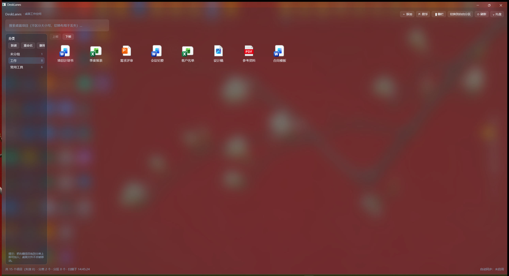
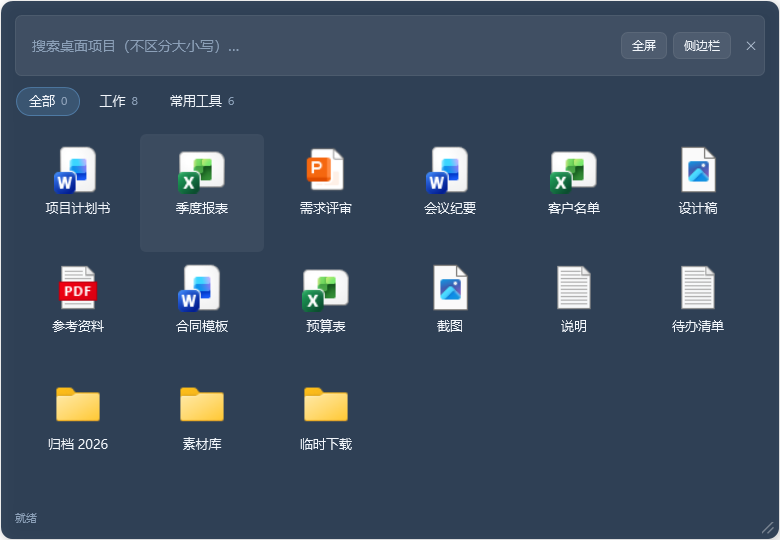
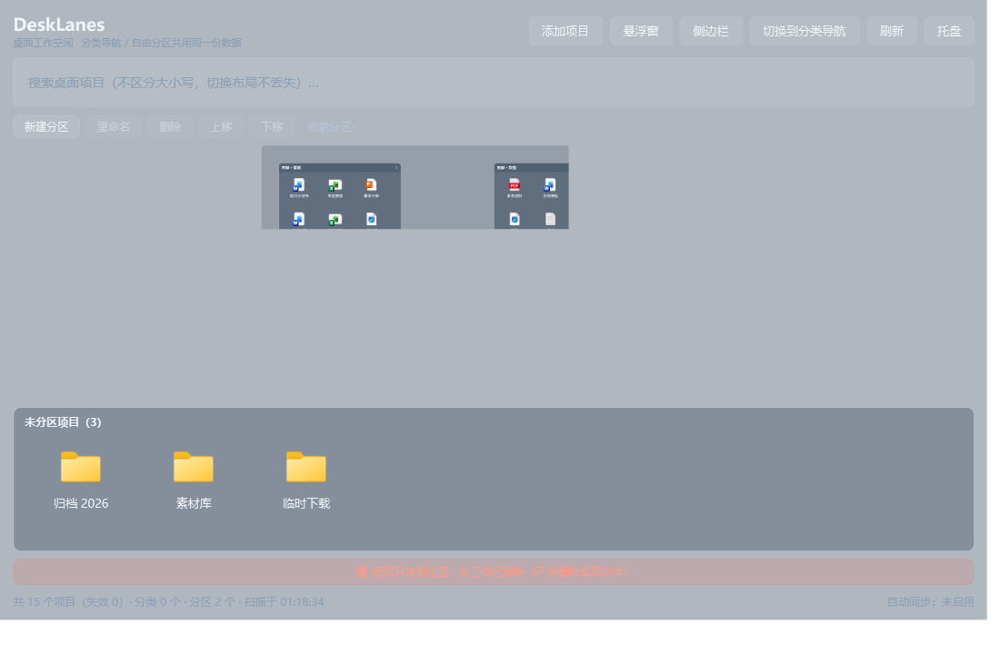
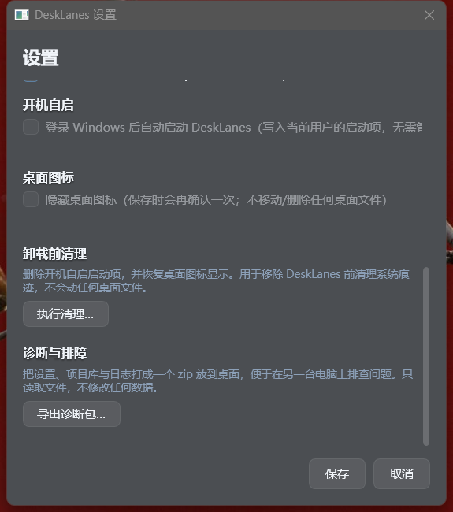

# DeskLanes · 一格桌面


> 源码：<https://github.com/Cang-Ruo/DeskLanes>

**Windows 11 本地桌面工作空间管理器**：把桌面项目组织成分类和自由分区，用三种随叫随到的界面形态取用——
**不动桌面上的任何一个文件**。

桌面乱，通常不是因为文件放错了地方，而是因为"找东西"这件事只能靠肉眼扫。
DeskLanes 的做法是：文件一个字节都不移动，只在自己的库里记录"哪个项目属于哪个分类/分区"，
然后给你一个全屏工作空间、一个快捷键呼出的悬浮搜索窗、一条贴在屏幕边缘的侧边栏。

- **零第三方依赖**：C# + WPF + .NET 10，热键 / 托盘 / 图标 / 快捷方式解析 / 已知文件夹全部 P/Invoke 自实现
- **一个窗口，三种形态，同一份数据**：切形态不丢任何分类、分区或搜索词
- **不碰你的文件**：分类与分区是虚拟的；拖出去"移除"也只是从库里摘掉，磁盘上的文件原封不动

---

## 三种形态

| 形态 | 适合什么 | 截图 |
|---|---|---|
| **全屏工作空间** | 认真整理的时候。两种布局：**分类导航**（左侧分类 + 右侧项目，拖进去即归类）与**自由分区**（自己摆面板、拖位置拉大小） |  |
| **悬浮窗** | 只想快点打开个东西。默认 `Ctrl`+`Alt`+`Space` 呼出，输入即过滤，回车打开 |  |
| **侧边栏** | 长期贴边待命。可停靠屏幕左/右，失焦自动收起 |  |

自由分区布局：



设置窗口（含快捷键、开机自启、桌面图标隐藏等开关）：



---

## 核心特性

**组织**
- 分类（分组）：新建 / 重命名 / 删除 / 上下排序，项目拖进去即归类
- 自由分区：自建面板，拖动移动、拉伸改大小，底部有"未分区项目池"
- 顶部搜索框实时过滤，切换布局不丢搜索词
- 自定义添加任意文件 / 文件夹为项目

**扫描与同步**
- 同时扫描用户桌面与公共桌面（`SHGetKnownFolderPath`，不是会踩坑的逻辑桌面）
- 解析 `.lnk` 快捷方式的真实目标
- `FileSystemWatcher` 实时监听 + 防抖 + 后台重扫；目录临时不可访问时自动降级为周期重扫
- 重命名可靠迁移：只有系统明确给出"旧路径 → 新路径"才迁移，绝不靠文件名或时间猜测
- 失效判定范围感知：只对本次成功枚举的目录判失效，避免"扫不到就被误删"

**系统集成**
- 全局快捷键（只支持组合键，不用键盘钩子、不注册裸 Win 键；带"测试"与被占用提示）
- 系统托盘（右键菜单可直接切形态）
- 开机自启、桌面图标隐藏 —— **默认关闭**，且需你逐次确认
- 托盘关闭 / 最小化到托盘

**配置与诊断**
- 配置与日志都在 `%LocalAppData%\DeskLanes\`（`settings.json`、`library.json`、`logs\`）
- 设置里可一键**导出诊断包**（配置 + 日志 + 备份清单打成 zip 放到桌面），报故障时直接把这个包发出去

---

## 实测数据

都是真机跑出来的，不是估计值：

| 项目 | 结果 |
|---|---|
| 冷启动 / 热启动到窗口可见 | 约 1.35 s / 约 1.25 s（本机实测；不同机器、不同负载下有 ±0.2 s 波动，判据 < 3 s）|
| 扫描 800 个项目 | 约 15 ms（合并进库约 8 ms） |
| 取 800 个图标 | 约 1.2 s（约 1.5 ms/个） |
| 分类视图 ↔ 自由分区切换（220 项目） | 最慢 349 ms |
| 6 小时驻留 | 私有内存首小时涨到 282 MB 后走平，最后 2 小时 +3.9 MB；句柄 / GDI / 线程不涨 |

---

## 安装

**直接用**：到 [Releases](https://github.com/Cang-Ruo/DeskLanes/releases) 下载
`DeskLanes-v0.2.0-selfcontained.zip`（约 62 MB，自带运行时），解压双击 `DeskLanes.exe` 即可。

分发物是一个单文件 exe，有**两个版本**：

| 版本 | 体积 | 目标机要求 |
|---|---|---|
| **自包含版**（推荐发给别人） | 约 62 MB | 无，自带 .NET 运行时，开箱即用 |
| **便携版** | 约 0.5 MB | 必须已装 .NET 10 **桌面**运行时（`Microsoft.WindowsDesktop.App` 10.x） |

绿色用法：把 `DeskLanes.exe` 双击打开就能用，不写注册表、不留痕迹，删掉即卸载。

完整安装（开始菜单入口 + 可在「设置 → 应用 → 已安装的应用」里卸载）：

```powershell
powershell -NoProfile -ExecutionPolicy Bypass -File install.ps1
```

卸载：`uninstall.ps1`（结束实例 → 删开机自启项 → 恢复桌面图标 → 删快捷方式与卸载项）。
配置目录**默认保留**，想彻底清除加 `-RemoveConfig`。

> 完整安装 / 卸载说明、参数表与在另一台电脑上的操作步骤见
> [`docs/install-and-uninstall.md`](docs/install-and-uninstall.md)。

---

## 从源码构建

需要 .NET 10 SDK（`net10.0-windows`，含 WPF 工作负载）。

```bash
dotnet build DeskLanes.sln -c Release

# 便携版
dotnet publish src/DeskLanes.App/DeskLanes.App.csproj -c Release -p:PublishProfile=win-x64-singlefile
# 自包含版
dotnet publish src/DeskLanes.App/DeskLanes.App.csproj -c Release -p:PublishProfile=win-x64-selfcontained
```

产物在 `publish/win-x64/` 与 `publish/win-x64-selfcontained/`。

跑测试：

```bash
dotnet run --project tests/DeskLanes.SmokeTests -c Release          # 冒烟（460 项）
python tools/verify-floating-interaction.py                          # 端到端 UI（真实 exe + 合成鼠标，36 项）
python tools/measure-startup.py                                      # 启动耗时（7 项）
python tools/soak-8h.py --exe <exe> --hours 6                        # 长时驻留资源采样
```

---

## 安全约定（设计红线）

1. 不移动、删除、修改桌面上的任何文件
2. 只写 HKCU 下三个点：Run 启动项、Uninstall 卸载项、`HideIcons`（由资源管理器自己写）
3. 不重启 Explorer（隐藏/恢复桌面图标走的是切换命令）
4. 开机自启与桌面图标隐藏默认关闭，需逐次授权
5. 不用键盘钩子、不注册裸 Win 键

---

## 已知限制（发布前请读）

简版，完整清单见 [`docs/known-limitations.md`](docs/known-limitations.md)：

- **没有数字签名**，双击可能触发 SmartScreen，需点「更多信息 → 仍要运行」
- **无自动更新**（刻意不做静默自更新），升级 = 覆盖安装
- **只支持 Windows 11**（玻璃材质走 DWM 系统背景：Acrylic 优先、Mica 降级，需 22621+）；Win10 兼容未验证
- DPI 已验证 100% / 125% / 150% 与竖屏混合 DPI；**200%+ 与 1366×768 及以下未覆盖**
- 长时驻留已实测 **6 小时**（内存走平、句柄不涨，`docs/stage9-8-soak/report.md`）；
  但**锁屏 / 睡眠唤醒后的行为未验证**，跨天（24h+）也没跑

---

## 文档

| 文档 | 内容 |
|---|---|
| [`docs/project-overview-and-roadmap.md`](docs/project-overview-and-roadmap.md) | 项目总览、功能清单、验证状态与后续建议（唯一基线） |
| [`docs/install-and-uninstall.md`](docs/install-and-uninstall.md) | 安装 / 卸载、两个版本怎么选、跨机器操作步骤 |
| [`docs/known-limitations.md`](docs/known-limitations.md) | 发布用已知限制完整清单 |
| `docs/stage9-4-*.md`、`stage9-5-*.md`、`stage9-6-*.md` | 悬浮窗拖动缩放、竖屏适配、图标缓存有界的实施与验收记录 |
| `docs/stage8-*.md` | 分发兼容性与跨设备验收（发布产物、干净环境、系统级验收、DPI 边界） |
