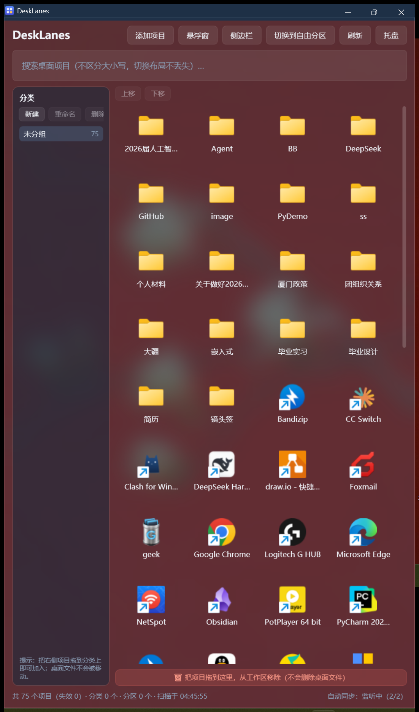
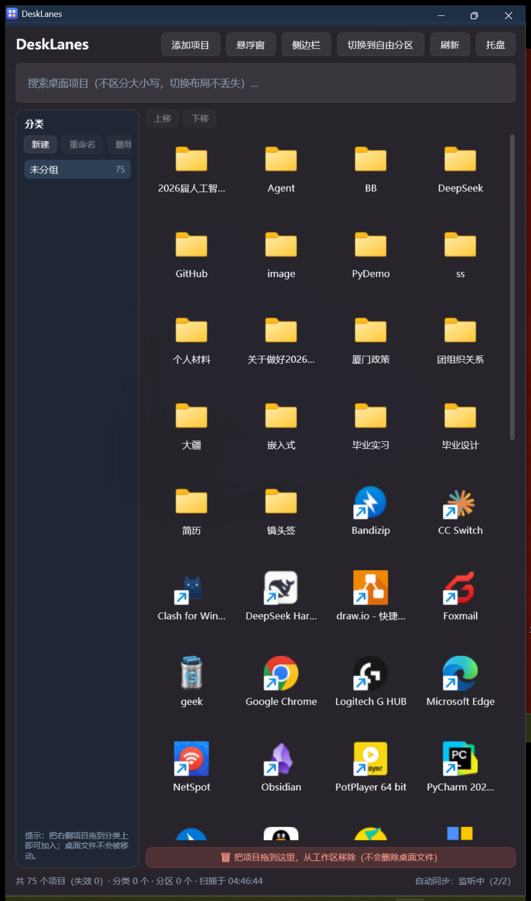

# 阶段 1：验证真正的 Desktop Acrylic

日期：2026-10-31 04:44 ~ 04:50
环境：Windows 11 Build 26300（22621+，支持 `DWMWA_SYSTEMBACKDROP_TYPE`）

---

## 一、结论（先说结果）

**阶段 1 通过。**

在当前 Windows 11 环境下，主窗口区域**确实能看到桌面背景经过模糊后的颜色和轮廓**——
前提是材质优先级正确。

原实现里那句注释 **"本机实测 Acrylic 不渲染" 是错的**。
真正的原因是：`WindowBackdropService` 把顺序写成了 Mica 优先，
而 Mica 在本机可以成功设置，于是**永远走不到 Acrylic 分支**——
不是 Acrylic 不工作，是它压根没机会执行。

---

## 二、为什么之前会得出"不渲染"的错误结论

排查过程中发现一个取证方法上的致命问题（`tests/DeskLanes.UiSnapshot/Program.cs`
第 17-23 行的注释本身就写着）：

```
category / panels / floating / sidebar → RenderTargetBitmap（视觉树快照）
settings / dialog → GDI BitBlt 屏幕合成截图（能看到 DWM 的 Mica 毛玻璃）
限制：RenderTargetBitmap 抓不到 DWM 合成的 Mica / 亚克力毛玻璃与桌面壁纸
```

也就是说：
- 主窗口（category / panels）用的是 **RenderTargetBitmap**
- 而 RenderTargetBitmap 抓的是 **WPF 视觉树**，**看不到 DWM 材质**

**用一张本来就看不出材质差异的图，去判断"材质有没有生效"，
无论把材质设成什么，结论都会是"没区别"。**
这个错误结论又被写回代码注释，固化成了"Mica 优先"的依据。

---

## 三、这次的验证方法

### 3.1 新增诊断开关

在 `WindowBackdropService` 里加了环境变量强制指定材质的能力
（保留下来，以后排查"材质在别人机器上不生效"这类问题也用得上）：

```
DESKLANES_BACKDROP = auto | none | mica | acrylic | tabbed
```

### 3.2 新增真实屏幕合成截图工具

`tools/screenshot.py` —— GDI BitBlt 屏幕合成截图，零第三方依赖，输出 PNG。
**这是本阶段能得出正确结论的关键**：只有屏幕合成截图才能拍到 DWM 材质。

配合 `tools/probe-acrylic.py`：清出桌面 → 以指定材质启动真实 exe
→ 等窗口矩形稳定 → 截屏 → 定量分析像素。

### 3.3 关键判据

不只看"API 返回成功"，而是**在窗口背后放已知的、有图案的桌面壁纸
（深红底 + 白色玉兰花）**，看窗口内是否能看到被模糊的图案。

---

## 四、实测结果

### 4.1 API 写入 / 读回

| 设置 | `DwmSetWindowAttribute` | 读回 `applied` |
|---|---|---|
| Acrylic (`DWMSBT_TRANSIENTWINDOW`=3) | `hr=0x00000000` (S_OK) | **3** ✅ |
| Mica (`DWMSBT_MAINWINDOW`=2) | `hr=0x00000000` (S_OK) | **2** ✅ |

两者 API 层面**都返回成功**——所以"只看返回值"根本区分不出差别，
这再次说明必须用真实截图取证。

### 4.2 像素分布（窗口中心区，54233 个采样点）

| 材质 | R 标准差 | G 标准差 | B 标准差 | 唯一颜色数 |
|---|---|---|---|---|
| Acrylic | 42.63 | 43.00 | 32.60 | **5486** |
| Mica | 51.90 | 45.19 | 33.89 | 2549 |

### 4.3 截图对比（关键证据）

| Acrylic | Mica |
|---|---|
|  |  |

- **Acrylic**：背景呈现深红色调的半透明效果，带明暗不一的模糊斑块，
  能辨认出壁纸里白玉兰花枝的轮廓与明暗层次。
- **Mica**：整块**均匀深灰**，完全没有图案、没有纹理层次，
  只是把壁纸的主色调"抹平"成一片颜色。

这正好对应微软的定义：
**Mica 是不透明材质（只融入壁纸颜色），Acrylic 是半透明磨砂玻璃（能看到模糊后的桌面内容）。**

---

## 五、已做的代码修改

`src/DeskLanes.App/Services/WindowBackdropService.cs`

1. **材质优先级反转**：`Acrylic 优先 → 失败退 Mica → 再退不透明底色`
   （原：`Mica 优先 → 失败退 Acrylic`）
2. **新增 `ForcedBackdrop`**：读 `DESKLANES_BACKDROP` 环境变量，用于诊断
3. **新增 `WriteProbe`**：把每次材质决策写入
   `%LocalAppData%\DeskLanes\backdrop-probe.txt`，便于在别的机器上取证
4. **修正读回判据**：原来是 `applied > 0`，但 `auto` 的合法值就是 0，
   会把它误判成失败并退回不透明底色；改为 `applied != none(1)`

`src/DeskLanes.Core/Native/DwmInterop.cs`

- 补齐 backdrop 常量：`BackdropAuto(0)` / `BackdropNone(1)` /
  `BackdropMica(2)` / `BackdropAcrylic(3)` / `BackdropTabbed(4)`
- 补 `DWMWA_USE_HOSTBACKDROP_BRUSH(17)`（Win10 时期的旧式背景画刷，供降级路径使用）

---

## 六、下一步

阶段 1 判据已满足，可以进行阶段 2：

- 顶部工具栏弱化（缩小标题、按钮改轻量图标 / 低对比度、搜索框不占满整行）
- 左侧分类导航玻璃化（保留 165~185 DIP 宽度、选中态用低透明蓝）
- 项目分区玻璃化（轻玻璃面板、低透明度 + 细微描边、不用重阴影）
- 自由分区模式统一材质
- 底部移除区域低存在感处理（非拖拽时隐藏或中性提示）

---

## 附：本次新增工具

| 文件 | 用途 |
|---|---|
| `tools/screenshot.py` | 真实屏幕合成截图（GDI BitBlt，零依赖），输出 PNG |
| `tools/probe-acrylic.py` | 材质取证探针：清桌面 → 指定材质启动真实 exe → 等稳定 → 截屏 → 分析 |
