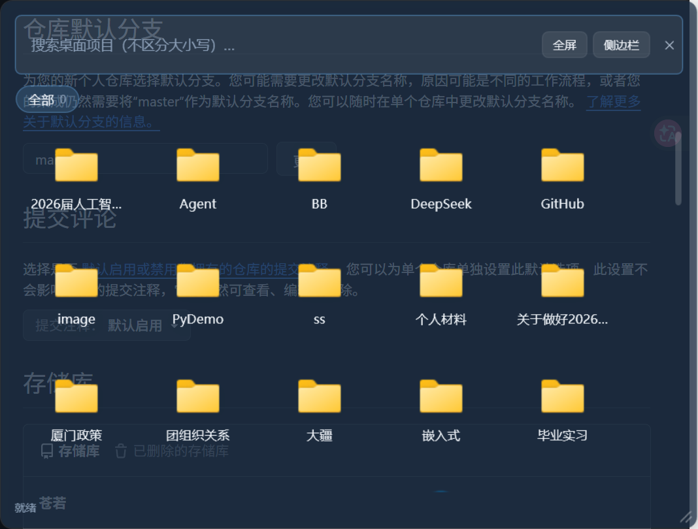
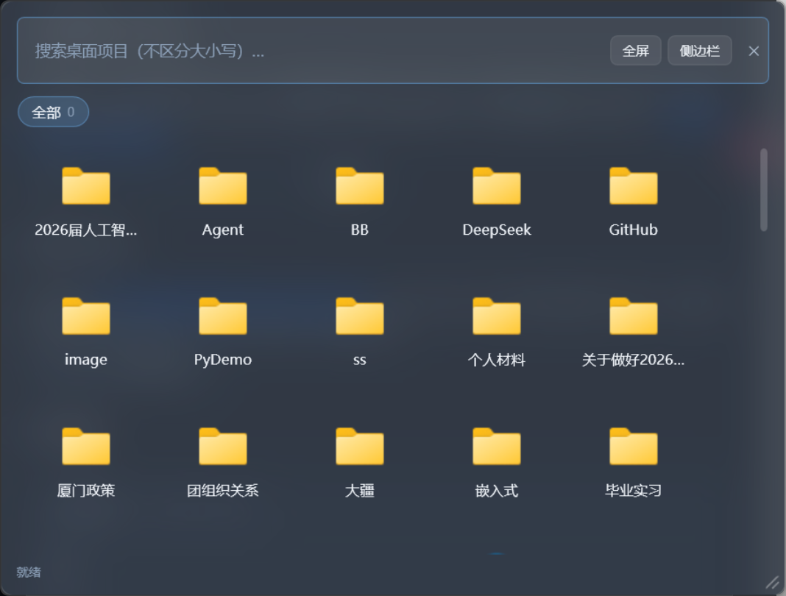

# UI 二次视觉修正：阶段 2 ~ 4 报告

日期：2026-10-31（阶段 2：05:00 前后 / 阶段 3：14:20 前后 / 阶段 4：14:30 前后）
前置：阶段 1 已确认 Desktop Acrylic 在本机（Build 26300）真实生效，
之前"Acrylic 不渲染"的结论源于取证方法错误（详见 `stage1-report.md`）。

---

## 阶段 2：主窗口视觉结构（已完成）

### 材质分层

| 画刷 | 改前 | 改后 | 说明 |
|---|---|---|---|
| `BrushWindowBaseGlass` | 35% | **18%** | 窗口基底 tint，太实会盖掉 Acrylic |
| `BrushNavGlass` | 55% | **35%** | 左侧导航，保持比内容深一档 |
| `BrushPanelGlass` | 30% | **14%** | 内容面板 |
| `BrushCardGlass` | 45% | **24%** | 分区卡片 |

### 标题栏融合

发现新问题：延伸玻璃框后，原生标题栏仍是深色实心条，与玻璃区域割裂。
Acrylic 生效时改为 `DWMWA_COLOR_NONE`（标题栏不绘制颜色，透出材质）；
Mica / 回退路径保持深色衔接。

### 顶部弱化（MainWindow）

- 标题 19px 粗体 → **13px 中等字重** + 次级文字色；副标题缩为一行小字
- 六个按钮：内边距 14,7 → 9,4、字号 13 → 12、轻量符号前缀
- 搜索框：不再横跨整窗，固定 **420 DIP** 左对齐

### 移除区按需显隐（新增 `DragState` 服务）

底部红色移除区此前常驻，视觉上不停抢戏。新增全局拖拽状态：
- 引用计数（防嵌套 DragOver 误清零），`ItemTile` 拖拽开始置位、
  `DoDragDrop` 返回即复位（同步阻塞，天然可靠）
- 两个布局视图的移除区绑定该状态：**拖起来才出现，拖完就藏**
- 拖拽行为与「不动桌面文件」的安全规则完全不变

---

## 阶段 3：悬浮窗统一 Acrylic（已完成）

### 遇到的弯路（值得记录）

先试了**最低成本方案**：保持分层窗口，把底色从 90% 降到 75%。
实测失败——分层窗口没有模糊能力，75% 透明后**后面窗口的文字会清晰透进来**
（截图 `05-floating.png`：Git 客户端的"仓库默认分支""提交评论"等文字
和悬浮窗内容混在一起，完全不可读）。

这正是 DWM Acrylic 存在的意义：**模糊滤掉后面内容的细节，只留颜色轮廓**。
半透明 ≠ 磨砂，分层窗口给不了磨砂。

### 最终改法：WindowChrome 非分层窗口

`FloatingWindow` 从 `AllowsTransparency=True` 改为 WindowChrome 非分层窗口：

```
CaptionHeight=0, ResizeBorderThickness=0, GlassFrameThickness=0, UseAeroCaptionButtons=False
```

- 系统不接管标题栏与缩放边框 → **拖动与八方向缩放热区行为不变**
- 背景走 `WindowBackdropService` 同一条 Acrylic 路径
- 根 Border 背景绑定 `Window.Background`：Acrylic 成功时是轻 tint，
  材质不可用回退时自动变回不透明底色，两种状态都可读
- 去掉自绘 `DropShadowEffect`：Win11 非分层窗口自带系统阴影

### 侧边栏为什么不改

侧边栏是**贴边窗口**：DWM 圆角会把贴边侧切成缺角；且需求只点名悬浮窗。
保持分层窗口 + 90% 不透明底色（`BrushSidebarGlass` 恢复原值）。

### 效果对比

| 75% 半透明（失败方案） | WindowChrome + Acrylic（最终） |
|---|---|
|  |  |

---

## 阶段 4：回归测试（全部通过）

| 项目 | 结果 |
|---|---|
| Release 构建 | 0 警告 0 错误 |
| 冒烟测试 | **460 / 460** |
| 端到端 UI（真实 exe + 合成鼠标） | **36 / 36**（拖动 / 八方向缩放 / 跨屏 / 竖屏收缩 / 位置持久化） |
| 启动性能 | **7 / 7**（热中位 1.25 s） |
| **失焦自动隐藏**（新增专项探针） | **PASS**——临时开启 `FloatingHideOnDeactivate`，记事本抢焦点后悬浮窗消失，配置已恢复 |
| 布局切换性能 | **PASS**（75 项目 median 240 ms / max 266 ms，判据 < 1 s） |
| UiSnapshot 全模式 | category / panels / sidebar 正常渲染，自由分区底部无残留红条 |

失焦隐藏此前被端到端刻意排除（会与合成点击竞态），本次用
`tools/probe-focus-loss.py` 专项补上。

---

## 验收判据核对

> **打开 DeskLanes 时，第一眼应该感觉桌面上浮现了一层半透明的玻璃工作空间，
> 而不是打开了一个深色的软件窗口。**

`04-stage2-final.png`：整窗磨砂玻璃，深红壁纸与白玉兰花枝的模糊影像透出，
标题栏与玻璃融为一体，无常驻红条，视觉重心落在项目图标上。**达成。**

> 切换不同壁纸时，应能明显感受到背景颜色和轮廓的变化。

Acrylic 是实时模糊：壁纸换色，窗口背景立即跟随（材质由 DWM 按需重采样）。

---

## 遗留说明

1. **侧边栏**仍是分层窗口深色底——有意保留（贴边场景 + 缺角风险）。
   如果后面想要统一，需要设计贴边窗口的圆角/材质方案再动。
2. **`UiSnapshot` 对 category / panels 仍用视觉树快照**（抓不到材质）。
   对外展示"玻璃效果"请用 `tools/probe-acrylic.py` / `tools/probe-floating.py`
   的屏幕合成截图，或 `tools/screenshot.py`。
3. **Win10 / 远程会话**仍走不透明回退（`SupportsSystemBackdrop` / `IsRemoteSession` 检查），
   行为与改版前一致，窗口永远可见。
